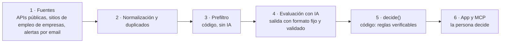

# Job Search OS

Sistema de búsqueda laboral para perfiles de tecnología y carreras digitales: junta ofertas de fuentes públicas y de alertas por email, descarta lo que no encaja con reglas en código, evalúa el resto con un modelo de lenguaje y deja que **el código decida** la acción (aplicar, guardar o descartar) con el porqué a la vista. La persona decide y postula por su cuenta.

**Tesis:** el modelo evalúa, el código decide, el humano interviene solo donde hace falta.

- App pública: <https://busquedalaboral.malejo.com.ar/>
- Demo para recorrer sin registrarse: <https://busquedalaboral.malejo.com.ar/demo>
- Cómo está hecho, explicado para quien no programa: <https://busquedalaboral.malejo.com.ar/como-esta-hecho>

<!-- capturas: docs/img/ (pendiente) -->

## In English

Job Search OS is a job-search assistant built as a portfolio project. It ingests public job feeds and forwarded alert emails, drops poor fits with deterministic rules, scores the rest with an LLM against a candidate profile, and then lets plain code (`decide()`) make the final call: apply, save or discard. The model suggests; the code decides.

Engineering highlights: a pure TypeScript pipeline with no I/O, schema-validated LLM output (Zod), an eval harness with a golden set and adversarial prompt-injection cases, per-user Postgres row-level security, parsers that fail closed, hard cost caps on every LLM run, and CI gates plus a post-deploy smoke test. It never scrapes LinkedIn and never submits applications (see [ADR-004](docs/adr/004-no-scraping-linkedin-no-autoapply.md)). Docs and UI are in Spanish; code identifiers are in English. Start with [docs/ARCHITECTURE.md](docs/ARCHITECTURE.md) and the [ADR index](#decisiones-de-ingeniería) below.

## Arquitectura

El recorrido de una oferta, con las mismas seis etapas que muestra [/como-esta-hecho](https://busquedalaboral.malejo.com.ar/como-esta-hecho) (fuente del diagrama: `apps/web/app/(public)/como-esta-hecho/flow-diagram.tsx`):



- **Pipeline puro** en `packages/pipeline`: normalización, dedup, prefiltro, `decide()`, máquina de estados. No importa la base ni los adapters y no hace I/O: recibe datos y devuelve decisiones ([ADR-001](docs/adr/001-monorepo-y-adapters.md)).
- **Adapters** en `packages/adapters`: fuentes, email entrante, worker, cliente LLM, MCP. **Base** en `packages/db` (Drizzle sobre Postgres). **Prompts** versionados en Markdown en `packages/prompts`. **App** Next.js en `apps/web`. **Harness de evals** en `evals/`.
- **Ruteo de modelos** por tabla (`model_routing`), no por nombres hardcodeados ([ADR-005](docs/adr/005-ruteo-de-modelos-y-migracion-gemini.md)).
- **Servidor MCP propio** en `apps/web/app/api/mcp/route.ts`, para consultar y operar desde un asistente de IA.
- **Cron**: GitHub Actions llama a las rutas de `apps/web/app/api/cron/` (ingesta, evaluación, mercado, estado y demo guiada). Programación en `.github/workflows/cron.yml`.

Detalle completo en [docs/ARCHITECTURE.md](docs/ARCHITECTURE.md) y [docs/SCHEMA.md](docs/SCHEMA.md).

## Decisiones de ingeniería

Cada decisión está en [`docs/adr/`](docs/adr/) con contexto, alternativas y consecuencias.

| ADR | Decisión |
|---|---|
| [001](docs/adr/001-monorepo-y-adapters.md) | Monorepo con pipeline puro y adapters intercambiables. |
| [002](docs/adr/002-multitenant-desde-fase-1.md) | Multi-tenant en schema y auth desde la primera fase. |
| [003](docs/adr/003-email-forwarding-en-vez-de-gmail-oauth.md) | Ingesta de emails por reenvío a una casilla propia, no por Gmail OAuth. |
| [004](docs/adr/004-no-scraping-linkedin-no-autoapply.md) | Ni scraping de LinkedIn ni postulación automática. |
| [005](docs/adr/005-ruteo-de-modelos-y-migracion-gemini.md) | Ruteo de modelos por tabla y migración de modelo. |
| [006](docs/adr/006-deduplicacion.md) | Criterio de deduplicación en dos niveles. |
| [007](docs/adr/007-aws-diferido-con-portabilidad.md) | AWS diferido, portabilidad desde el día 1. |
| [008](docs/adr/008-privacidad-y-datos-de-terceros.md) | Privacidad de datos de usuarios. |
| [009](docs/adr/009-neon-en-vez-de-supabase.md) | Neon como base en la nube en vez de Supabase. |
| [010](docs/adr/010-authjs-en-vez-de-neon-auth.md) | Auth.js en vez de Neon Auth. |
| [011](docs/adr/011-disciplina-distinta-hunde-el-score.md) | Una disciplina distinta bloquea y hunde el score; la modalidad solo bloquea. |
| [012](docs/adr/012-recuperacion-de-contrasena.md) | Recuperación de contraseña por email y setup inicial. |
| [013](docs/adr/013-dedup-exige-url-o-jd.md) | Dedup: empresa y título solos ya no fusionan. |
| [014](docs/adr/014-pool-global-de-ofertas-publicas.md) | Pool global de ofertas públicas, sin datos de personas. |
| [015](docs/adr/015-carreras-digitales.md) | Carreras digitales además de IT. |
| [016](docs/adr/016-varios-puestos.md) | Varios puestos a la vez, con tope por plan. |
| [017](docs/adr/017-evaluador-texto-de-terceros.md) | El texto del aviso es dato, no instrucción (defensas contra prompt injection). |
| [018](docs/adr/018-fuentes-pool-ats.md) | Fuentes del pool: feeds y sitios de empleo públicos; portales sin API, solo por email. |

Algunas decisiones tempranas fueron reemplazadas por otras posteriores (por ejemplo, la base pasó de Supabase a Neon en el ADR-009 y la auth a Auth.js en el ADR-010); los ADR se conservan como historia.

## Cómo se evita que la IA invente

- **Golden y evals** (`evals/`): un golden anonimizado de 36 ofertas más 4 avisos adversariales (`evals/fixtures/golden.json`, `evals/fixtures/adversarial.json`) contra el que se mide cada versión del prompt. Métricas estrictas y laxas: error absoluto del score, recall de bloqueadores, falsos "aplicar", falsos descartes y resistencia a instrucciones escondidas en el aviso. Detalle en [evals/README.md](evals/README.md).
- **Salida validada con Zod**: el cliente LLM (`packages/adapters/src/llm/client.ts`) pide un objeto con schema y un error de schema aborta en lugar de aceptar texto libre.
- **El modelo no decide**: `decide()` en `packages/pipeline` aplica reglas verificables (años exigidos, inglés, residencia, techo por título) sobre lo que devuelve el modelo.
- **Parsers de email que fallan cerrado**: si la estructura no es la esperada devuelven `{ ok: false }` y el email va a revisión manual; nunca extracción parcial ni campos inventados (`packages/adapters/src/inbound/`). Lo que el email no dice queda `null`.
- **El aviso es dato, no instrucción**: detector de instrucciones dirigidas al evaluador y tope de score en `decide()` ([ADR-017](docs/adr/017-evaluador-texto-de-terceros.md)).
- **Tope de costo**: `pnpm evals run` aborta si la estimación supera `--max-usd` (por defecto USD 1) y corta la corrida si el gasto real lo alcanza; el worker respeta un tope diario (`LLM_DAILY_CAP_USD`). Números y guardarraíles en [docs/LLM_COSTOS.md](docs/LLM_COSTOS.md).

## Seguridad y privacidad

- **RLS por usuario**: las tablas con datos de usuario tienen `user_id` y políticas de Row Level Security con `FORCE`, definidas en `packages/db/rls/`. La app usa un rol sin `BYPASSRLS` y fija el usuario por request. Hay tests de integración que lo verifican (`packages/db/src/rls.integration.test.ts`).
- **Email externo aislado**: el HTML de un email nunca se inyecta en la página; se muestra en un `iframe` con `sandbox` vacío (`apps/web/app/(app)/inbox/[id]/page.tsx`).
- **Nunca postula y nunca navega LinkedIn** ([ADR-004](docs/adr/004-no-scraping-linkedin-no-autoapply.md)): las fuentes son APIs y sitios públicos, alertas reenviadas por la persona y carga manual.
- **Repo público sin datos personales**: los datos reales viven en `fixtures-private/` (ignorado por git); el repo trae un dataset de ejemplo con empresas anonimizadas. Hay escaneo de secretos con gitleaks en CI.
- **Carril verde y carril rojo** (`.github/carril-rojo.txt`, [docs/CARRIL_VERDE.md](docs/CARRIL_VERDE.md)): el carril rojo es la lista de rutas sensibles (migraciones, schema, RLS, CI, scripts, infraestructura, entre otras). Un PR que toca alguna no se mergea solo y exige la revisión del dueño; un PR que no toca ninguna, con las revisiones y el CI en verde, puede mergearse automáticamente. El check `carril` se evalúa desde `main`, así que un PR no puede cambiar las reglas con las que se lo juzga.

## Calidad

Conteo **al 21/10/2026**, sobre el árbol del repo. Método: archivos `*.test.ts` (unit), `*.integration.test.ts` (integración) y `apps/web/e2e/*.spec.ts` (e2e) bajo `packages/`, `evals/` y `apps/`, sin `node_modules`; casos = líneas que empiezan con `it(`/`test(` (y sus variantes `.each`/`.skip`/`.only`) buscadas con ripgrep. Un `it.each` cuenta una vez aunque corra varias filas, así que son cifras mínimas.

| Tipo | Herramienta | Archivos | Casos |
|---|---|---|---|
| Unit | Vitest (`packages/*`) | 141 | 1721 |
| Unit del harness de evals | Vitest (`evals/src`) | 6 | 88 |
| Integración | Vitest + Postgres real | 50 | 457 |
| End to end | Playwright (`apps/web/e2e`) | 56 | 177 |

Los 4 specs de persona (`28` a `31`) reutilizan un flujo compartido (`apps/web/e2e/personas/flow.ts`) y ese flujo no entra en el conteo de e2e. Las corridas de evals contra un modelo real no son tests: son mediciones pagas con reporte (`evals/README.md`).

**CI** (`.github/workflows/ci.yml`), en cada PR y en cada push a `main`:

- `secrets`: gitleaks sobre toda la historia.
- `lint-typecheck`: ESLint, Prettier, TypeScript y el test del check `carril`.
- `unit`, `integration` (Postgres con pgvector) y `build`.
- `e2e`: Playwright contra Postgres y worker en modo demo, sin llamadas pagas.
- `evals`: solo si el PR toca `packages/prompts` o `evals`; corre un subset con tope de costo y se saltea con aviso si no hay key.

**Smoke post-deploy** (`.github/workflows/smoke.yml`): después de cada deploy a producción corre una prueba de solo lectura con una cuenta de prueba; si falla, abre un issue `smoke-roto`.

## Stack

Next.js 15 (App Router, Server Components) · TypeScript estricto · Tailwind · Framer Motion · Drizzle + Postgres (Neon en producción, Docker en local; pgvector) · Auth.js · Vercel AI SDK con Gemini y Anthropic · Zod · Vitest y Testcontainers · Playwright · pnpm + Turborepo · GitHub Actions · MCP · despliegue en Vercel.

## Correr en local

Necesitás Node 22 o superior, pnpm y Docker Desktop.

```bash
pnpm install
pnpm db:up                 # Postgres 16 + pgvector en Docker
pnpm db:migrate:local && SEED_USER_EMAIL=vos@mail SEED_USER_PASSWORD=algo-largo pnpm db:seed:local
pnpm --filter @job-search-os/web dev   # http://localhost:3000, contra la base de Docker
```

Usá siempre las variantes `:local`: los comandos sin `--local` apuntan a la base remota. Sin key de LLM el sistema funciona igual: `pnpm worker:evaluate --local --demo` usa un modelo falso. Antes de un PR: `pnpm lint && pnpm typecheck && pnpm test`. Comandos, dataset de ejemplo e índice completo de documentación en [docs/DESARROLLO.md](docs/DESARROLLO.md).

## Autor

Hecho por Mauro Lizárraga · [malejo.com.ar](https://malejo.com.ar) · @lizarragamauroalejandro
