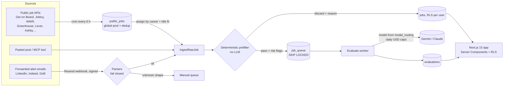

# AfinIAJobs in one page (for technical interviews)

AfinIAJobs helps a job seeker decide **where to apply**: it collects job posts (public sources, forwarded alert emails, pasted posts), filters them with deterministic rules, scores each one against the person's profile with an LLM, and explains in plain Spanish what is in their favor and what is missing. It never applies on the person's behalf (ADR-004). Closed beta for six non-tech careers (law, accounting, business, communications, marketing/PR, international relations) opens on 26 Nov 2026.

## System

- **Monorepo** (pnpm + Turborepo): `packages/pipeline` (pure domain logic, no I/O), `packages/adapters` (DB, LLM, email, sources), `packages/db` (Drizzle schema, migrations, RLS), `packages/prompts` (versioned Markdown prompts), `apps/web` (Next.js App Router), `evals` (offline scoring harness).
- **Postgres on Neon** with **row-level security**: every request runs in a transaction that sets `app.user_id`; policies scope every user table. Cross-user aggregates for admins go through `SECURITY DEFINER` functions with a fixed `search_path` and an `app_admins` check — two independent barriers (app allow-list + database).
- **Queue** in Postgres (`FOR UPDATE SKIP LOCKED`) instead of a broker: one less service; the interface is swappable (ADR-007 keeps an AWS path).

## Key decisions (and why)

| Decision | Why |
| --- | --- |
| Pure `pipeline` package: receives data, returns decisions, `Result<T, E>` instead of exceptions | Most logic (prefilter, title fit, score display, health thresholds, CSV escaping) is unit-tested without a database or a model |
| Deterministic prefilter before any LLM call | Cheap rules discard most noise (wrong discipline, modality, seniority); location never discards, it only flags a risk (unknown ≠ "anywhere") |
| Email parsers **fail closed** | An unexpected email goes whole to a manual queue; no partial extraction, no invented fields |
| Models come only from a `model_routing` table, with primary + fallback and per-task prices | Switching models is data, not code; spend is capped globally and per user per day |
| Prompts as versioned files + an offline golden set | Prompt changes are measured before merging; the paid eval job only runs when prompts or evals change |
| Feature flags off by default, migrations generated and never auto-applied | Changes ship dark; the owner applies migrations and flips flags after review |
| Accessibility as a test, not a checklist | Every new screen runs axe (WCAG 2.1 AA) in light and dark mode at 390 px in Playwright |

## Numbers (from the repository, Nov 2026)

- **30** ADRs, **60** Drizzle migrations, **19** RLS policy files.
- **~5,400** unit tests (254 files) and **~800** integration tests against a real Postgres (74 files).
- **118** Playwright specs (~650 end-to-end tests), run against a seeded Postgres with the LLM in demo mode (no paid calls in CI).
- **15** job-source adapters, **25** career profiles, **9** LLM tasks in `model_routing`.
- Measured cost of one evaluation: **≈ USD 0.0068** (~2,000 input / 420 output tokens). Daily cap for the beta: USD 4.

## Things I would talk about

- **Multi-tenant from day one** (ADR-002): RLS plus a test that fails if a new table with a `user_id` has no policy or is missing from account deletion.
- **Cost control** as a feature: per-plan evaluation limits, per-user and global 24-hour USD caps, and a health page that shows spend against the cap.
- **Neon egress budget** (5 GB/month on the free plan): the biggest win was storing derived facts (job language, English level) at ingest instead of re-reading full job texts on every market page.
- **Honest UX copy**: the score is called an estimate, unknown data is shown as "we don't know", and the app says that it never applies for you.
